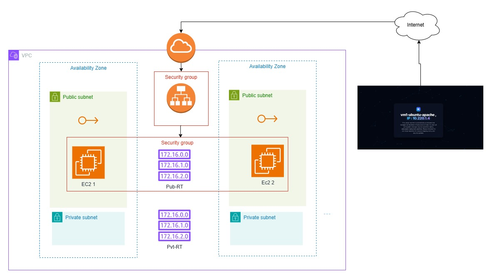

# Terraform AWS EC2 Multi-AZ

This project provisions a small, multi-AZ web application environment on AWS using Terraform. It creates a VPC with public and private subnets, deploys two Apache web servers, and places an Application Load Balancer in front of the servers.

## Architecture

The configuration currently deploys the following resources in `us-east-1`:

- One VPC
- Two public subnets:
  - `us-east-1a`
  - `us-east-1b`
- Two private subnets:
  - `us-east-1a`
  - `us-east-1b`
- An Internet Gateway and public route table
- A private route table
- Two EC2 instances, one in each public subnet
- An Elastic IP for each EC2 instance
- An internet-facing Application Load Balancer
- An ALB target group and HTTP listener
- Security groups for the EC2 instances and ALB

Each EC2 instance installs Apache through cloud-init and serves the project page from [`modules/ec2/index.html`](modules/ec2/index.html). The ALB health-checks the instances on port 80 and forwards HTTP traffic to healthy targets.



## Project structure

```text
.
├── main.tf                 # Composes the VPC, EC2, security group, and ALB modules
├── variables.tf            # Root input variables and defaults
├── terraform.tfvars        # Local example values; do not commit sensitive values
├── outputs.tf              # VPC, private IP, and ALB DNS outputs
├── provider.tf             # AWS provider configuration
├── backend.tf              # Optional remote state configuration (currently commented)
└── modules/
    ├── vpc/                # VPC, subnets, routes, and Internet Gateway
    ├── ec2/                # EC2 instance, Elastic IP, and cloud-init
    ├── security-groups/    # EC2 security group rules
    ├── ALB/                # Load balancer, listener, target group, and ALB SG
    └── s3/                 # Reusable S3 bucket module (not currently called by main.tf)
```

## Prerequisites

- An AWS account with permissions to create VPC, EC2, Elastic IP, security group, and ALB resources
- Terraform compatible with the AWS provider lock file
- AWS CLI credentials configured through one of the standard methods, such as:
  - `aws configure`
  - `AWS_ACCESS_KEY_ID` and `AWS_SECRET_ACCESS_KEY` environment variables
  - an IAM role
- An existing EC2 key pair in the selected AWS region
- An AMI that exists in the selected AWS region and supports the cloud-init configuration

The provider is configured for `us-east-1` in [`provider.tf`](provider.tf). The subnet availability zones are also hard-coded to `us-east-1a` and `us-east-1b`; update both before deploying in another region.

## Configuration

Copy the example variables file if needed:

```powershell
Copy-Item terraform.tfvars terraform.tfvars.local
```

Update the values in `terraform.tfvars` or provide another variable file. At minimum, verify:

- `my_ami` is a valid AMI for the target region
- `my_key_name` matches an existing EC2 key pair
- `my_ip_address` is your public CIDR in `/32` notation
- The VPC and subnet CIDRs do not overlap with networks you need to connect to
- The ALB and EC2 names are unique where AWS requires uniqueness

The `my_ip_address` value controls inbound HTTP and SSH access to the EC2 security group and inbound HTTP access to the ALB. Restrict it to a trusted address range rather than using `0.0.0.0/0`.

## Deploy

Initialize Terraform:

```powershell
terraform init
```

Format and validate the configuration:

```powershell
terraform fmt -recursive
terraform validate
```

Review the execution plan:

```powershell
terraform plan -var-file="terraform.tfvars"
```

Apply the infrastructure:

```powershell
terraform apply -var-file="terraform.tfvars"
```

After the apply completes, retrieve the ALB DNS name:

```powershell
terraform output alb_dns
```

Open the returned hostname in a browser using `http://`. It may take a few minutes for the instances to finish installing Apache and pass the ALB health checks.

## Destroy

Remove all resources managed by this configuration when they are no longer needed:

```powershell
terraform destroy -var-file="terraform.tfvars"
```

Review the destroy plan carefully before confirming. Elastic IPs and other AWS resources can incur charges while they remain allocated.

## State and security notes

- Terraform state can contain sensitive infrastructure details. Do not commit `terraform.tfstate`, `terraform.tfstate.backup`, or local variable files.
- The repository `.gitignore` excludes Terraform state, `.terraform`, and `*.tfvars` files.
- [`backend.tf`](backend.tf) contains an example encrypted S3 backend, but it is currently commented out. Configure a unique, pre-existing S3 bucket and enable the backend before using remote state in a shared environment.
- The private subnets currently have no NAT Gateway, so resources placed there would not have outbound Internet access.
- The EC2 instances are currently deployed in public subnets and receive Elastic IPs. For production workloads, consider placing application instances in private subnets and exposing only the ALB.
- The current listener and target group use HTTP on port 80. Add HTTPS and an ACM certificate before using this setup for production traffic.

## Outputs

| Output | Description |
| --- | --- |
| `VPC_ID` | ID of the created VPC |
| `EC2_a_IP` | Private IP of the first EC2 instance |
| `EC2_b_IP` | Private IP of the second EC2 instance |
| `alb_dns` | DNS name of the Application Load Balancer |

## License

No license has been specified for this project.
